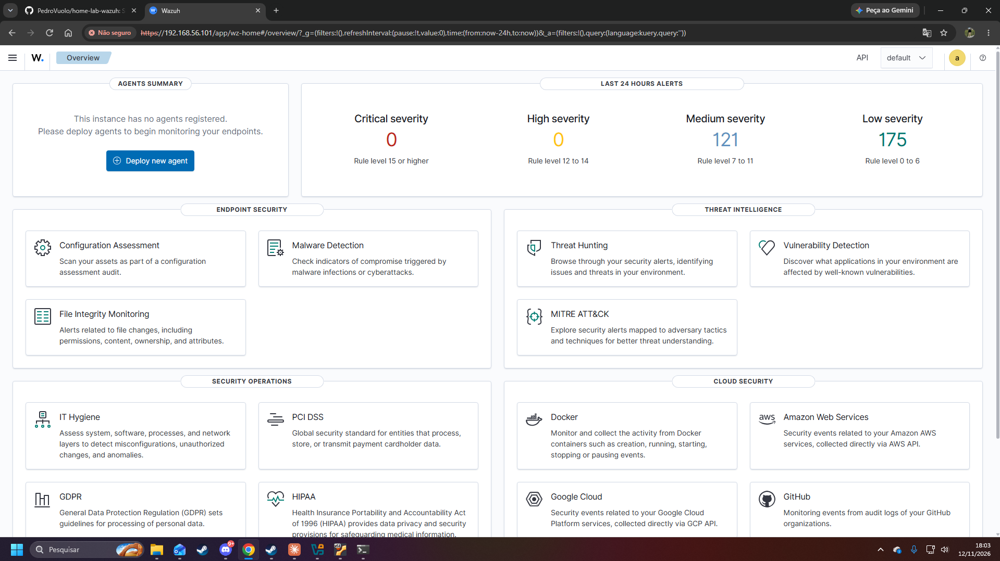
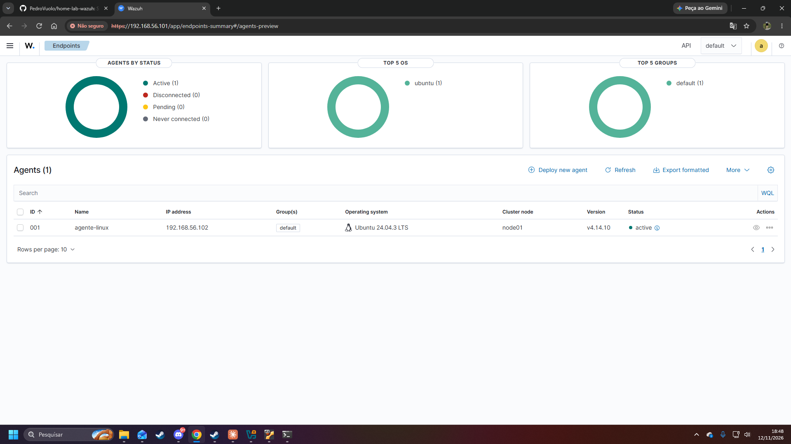
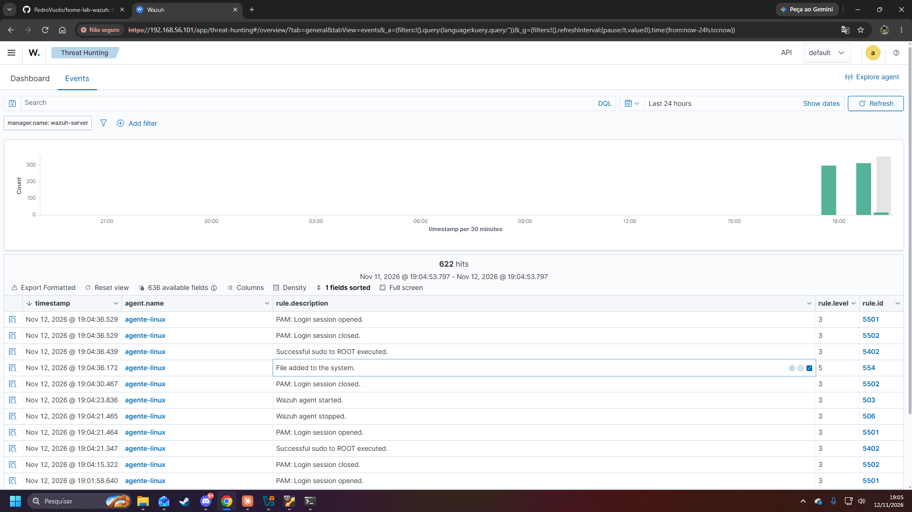
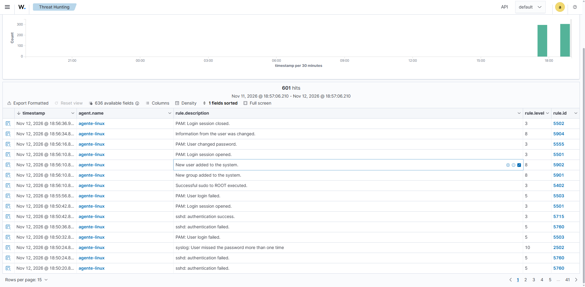
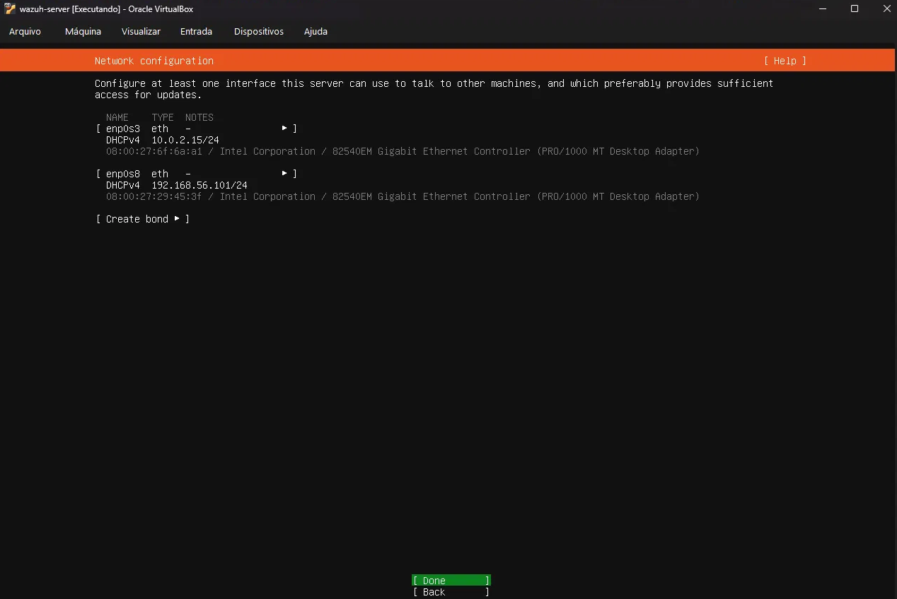
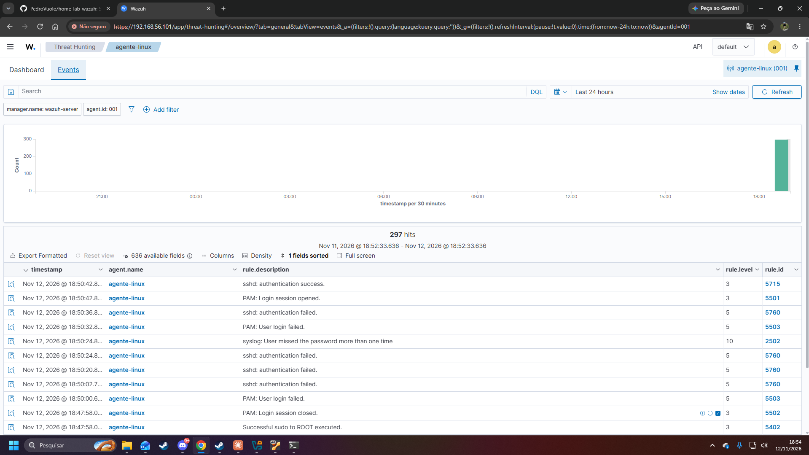

# home-lab-wazuh
SIEM home lab with Wazuh: VirtualBox setup, simulated events and alert investigation
# SIEM Home Lab com Wazuh

Home lab de detecção e investigação de eventos de segurança com Wazuh, montado no VirtualBox. Simulei três atividades em uma máquina Linux monitorada (logins falhos por SSH, criação de usuário e criação de arquivo em pasta monitorada) e investiguei os alertas gerados.

## Arquitetura

| Máquina | Função | Sistema | IP (rede host-only) |
| --- | --- | --- | --- |
| wazuh-server | Servidor Wazuh 4.14 (manager, indexer e dashboard) | Ubuntu Server 24.04 LTS | 192.168.56.101 |
| agente-linux | Máquina monitorada (agente Wazuh) | Ubuntu Server 24.04 LTS | 192.168.56.102 |

As duas máquinas têm dois adaptadores de rede: NAT (acesso à internet) e host-only (comunicação entre elas e com o navegador do computador hospedeiro).

## Passos principais

1. Instalar o VirtualBox e criar a máquina `wazuh-server` (8 GB de RAM, 4 processadores, 50 GB de disco).
2. Instalar o Ubuntu Server 24.04 LTS e conectar por SSH.
3. Instalar o Wazuh com o assistente oficial de instalação (`wazuh-install.sh -a`).
4. Criar a máquina `agente-linux` (2 GB de RAM, 2 processadores, 25 GB de disco) e instalar o agente com o comando gerado pelo painel.
5. Gerar eventos de propósito e investigar os alertas no módulo Threat Hunting.

## Prints

### Painel do Wazuh funcionando

### Agente conectado (status Active)

### Alerta de arquivo adicionado

### Alerta de usuário criado

### Rede das máquinas

## Investigações

### 1. Múltiplas falhas de login por SSH

**O que aconteceu.** Em 12/11/2026, por volta das 18:50, simulei tentativas de login por SSH com senha errada na máquina `agente-linux`, seguidas de um login com a senha correta.

**Por que o Wazuh alertou.** Cada falha gerou alertas de nível 5 (regras 5503, PAM: User login failed, e 5760, sshd: authentication failed). Depois de várias falhas seguidas, a regra 2502 (syslog: User missed the password more than one time) disparou com **nível 10**, porque o padrão repetido indica possível tentativa de adivinhar a senha. O login correto gerou as regras 5715 (sshd: authentication success) e 5501 (PAM: Login session opened), de nível 3.

**Como eu investigaria em um ambiente real.**

1. Identificar o IP de origem das tentativas e se ele é conhecido (rede interna, VPN ou externo).
2. Verificar se há muitas falhas em pouco tempo e em várias contas (força bruta ou password spraying).
3. Conferir se houve sucesso logo após as falhas, o que indicaria que a senha pode ter sido descoberta.
4. Se houve sucesso, revisar o que a conta fez depois (comandos, novos usuários, arquivos alterados) e considerar bloquear o IP e redefinir a senha.

**Técnica MITRE ATT&CK relacionada.** T1110 (Brute Force), tática Credential Access.

### 2. Criação de usuário

**O que aconteceu.** Criei o usuário `teste` na máquina `agente-linux` com o comando `adduser`, às 18:56 do mesmo dia.

**Por que o Wazuh alertou.** O Wazuh gerou "New user added to the system" (regra 5902, nível 8) e "New group added to the system" (regra 5901, nível 8), além de "PAM: User changed password" (5555, nível 3) e "Information from the user was changed" (5904, nível 8). O comando rodou com sudo, o que gerou também a regra 5402 (Successful sudo to ROOT executed, nível 3). Contas novas são monitoradas porque invasores costumam criar usuários para manter acesso.

**Como eu investigaria em um ambiente real.**

1. Confirmar quem executou o comando e se havia um chamado ou autorização para criar essa conta.
2. Ver se a conta foi criada logo depois de um login suspeito ou de uma elevação de privilégio com sudo.
3. Checar se a conta foi adicionada a grupos privilegiados e se já fez login.
4. Se não houver justificativa, desativar a conta e investigar a conta que a criou.

**Técnica MITRE ATT&CK relacionada.** T1136 (Create Account), tática Persistence.

### 3. Arquivo adicionado em pasta monitorada

**O que aconteceu.** Configurei a pasta `/home/teste-fim` para monitoramento em tempo real e criei o arquivo `arquivo.txt` dentro dela, às 19:04.

**Por que o Wazuh alertou.** O módulo de integridade de arquivos (syscheck) compara o estado dos arquivos e avisa quando um arquivo novo aparece ou muda. O alerta foi "File added to the system" (regra 554, nível 5), registrado às 19:04:36.

**Como eu investigaria em um ambiente real.**

1. Ver quem criou o arquivo e por qual processo, e se o caminho é esperado (pastas do sistema, como `/etc`, merecem mais atenção).
2. Calcular o hash do arquivo e consultá-lo em uma base de reputação, como o VirusTotal.
3. Verificar se aparecem outros arquivos novos ou alterados no mesmo horário.
4. Comparar com mudanças autorizadas (atualizações, deploys) antes de classificar como suspeito.

**Técnica MITRE ATT&CK relacionada.** Depende do arquivo. Neste caso, é uma atividade simulada de teste.

## O que aprendi

- Montar um ambiente de SIEM do zero: servidor, agente, rede com NAT e host-only.
- Diagnosticar e resolver um erro real de instalação: o painel do Wazuh falhou por **disco cheio** (o Ubuntu usou só 24 GB dos 50 GB do disco). Li o log de instalação, identifiquei a causa e ampliei o volume lógico (LVM) antes de reinstalar.
- Diferenciar severidades de alerta: falhas isoladas de login têm nível 5, mas o padrão repetido sobe para nível 10.
- Configurar monitoramento de integridade de arquivos em tempo real.
- Escrever investigações no formato de um analista: o que aconteceu, por que alertou, como investigar e técnica MITRE ATT&CK.

## Próximos passos

- Analisador de logs em Python para contar tentativas de login falhas por IP.
- Consultas em SQL sobre logs de acesso.
- Integração com consulta de reputação de IPs (VirusTotal).
